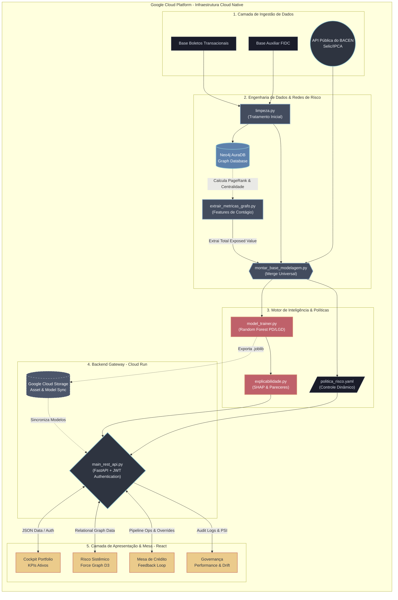

# 🏗️ Diagrama de Arquitetura: Motor MFS (Núclea)

Mapeamento visual do fluxo de dados _end-to-end_ do projeto, desde a prospecção dos dados originais e macroeconômicos até o ponto final de consumo no Dashboard e Mesa de Crédito Operacional.

### Entendendo a Legenda do Fluxo:
- ⬛ **Preto/Cinza Escuro**: Bases de Origem e arquivos de configuração (YAML/CSV).
- 🟦 **Azul Metálico**: Módulos Processadores de Limpeza e Cálculos de Grafo.
- 🟥 **Vermelho**: Motor de IA (Training, Explainability e Inferência).
- 🟨 **Amarelo/Ouro**: Interface de Usuário (Frontend modularizado).
- 🟩 **Ciano/Verde**: API Gateway (FastAPI) e Pontos de Integração.
- ⬜ **Tracejado**: Infraestrutura de suporte em nuvem (GCS/Cloud Run).
