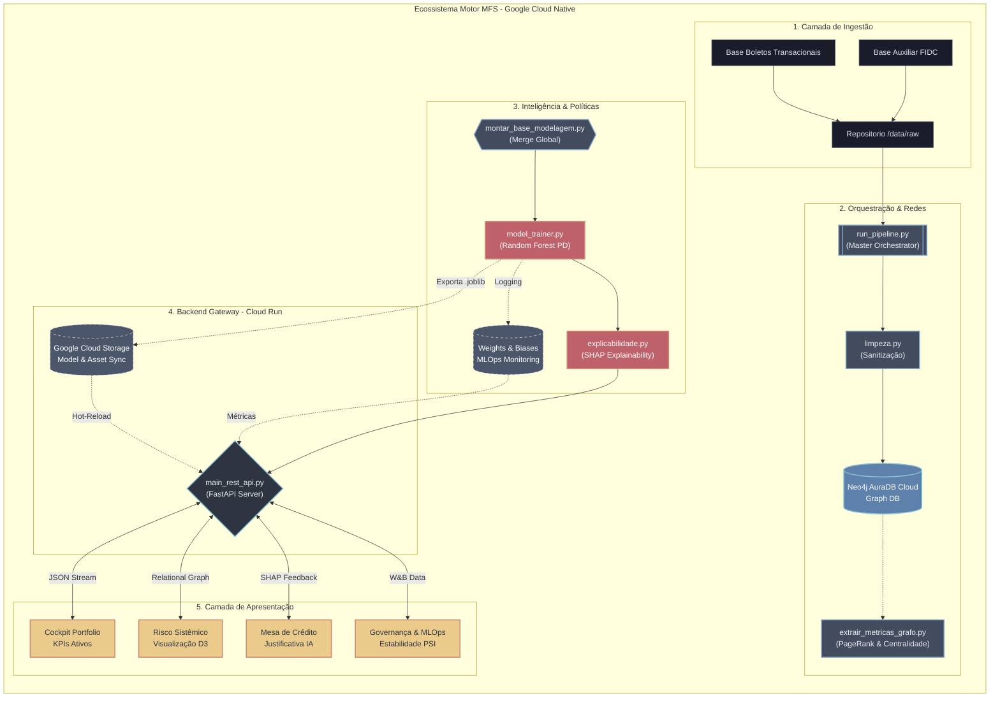

# Diagrama de Arquitetura: Motor MFS (Núclea)

Mapeamento visual do fluxo de dados _end-to-end_ do projeto, desde a prospecção dos dados transacionais até o ponto final de consumo no Dashboard e Mesa de Crédito Operacional.

### Entendendo a Legenda do Fluxo:
- **Preto/Cinza Escuro**: Bases de dados brutas e arquivos de configuração operacional.
- **Azul Metálico**: Módulos de processamento, banco de grafos e métricas de rede.
- **Vermelho**: Núcleo de Inteligência Artificial (Treinamento e Explicabilidade).
- **Amarelo/Ouro**: Interface React modularizada para consumo final.
- **Tracejado**: Camada de infraestrutura gerenciada (Google Cloud Platform).

---
**Status da Documentação:** Atualizada para a versão final (Remoção de Selic/BACEN).
