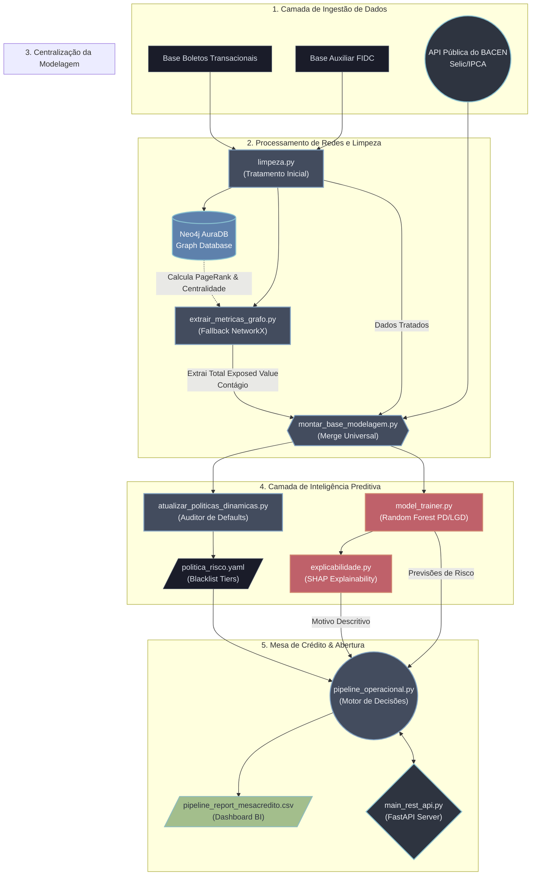

# 🏗️ Diagrama de Arquitetura: Motor MFS (Núclea)

Mapeamento visual do fluxo de dados _end-to-end_ do projeto, desde a prospecção dos dados originais e macroeconômicos até o ponto final de entrega na API REST e Mesa de Crédito.

### Entendendo a Legenda do Fluxo:
- ⬛ **Preto/Cinza Escuro**: Bases de Origem e arquivos crus.
- 🟦 **Azul Metálico**: Módulos Processadores de Limpeza e Cálculos de Grafo da base.
- 🟥 **Vermelho**: A "Caixa Preta". Processamento da IA (Scikit-Learn/SHAP).
- 🟩 **Ciano/Verde**: Endpoints Web e Arquivos Exportados Prontos (Dinheiro Blindado).
